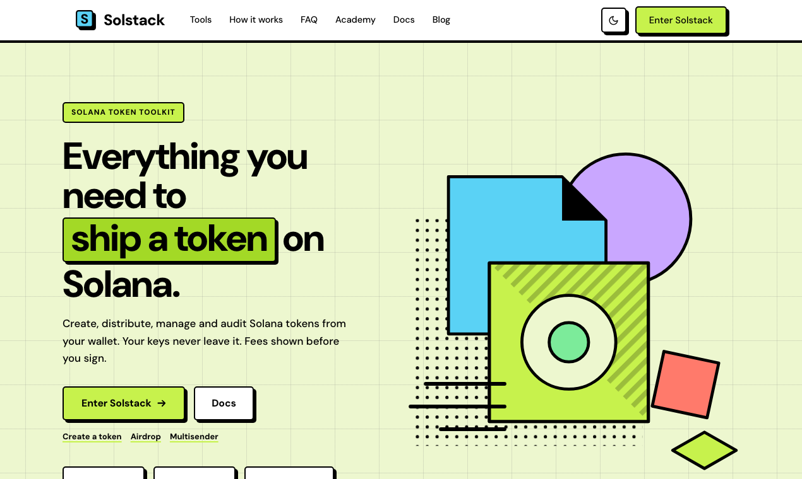
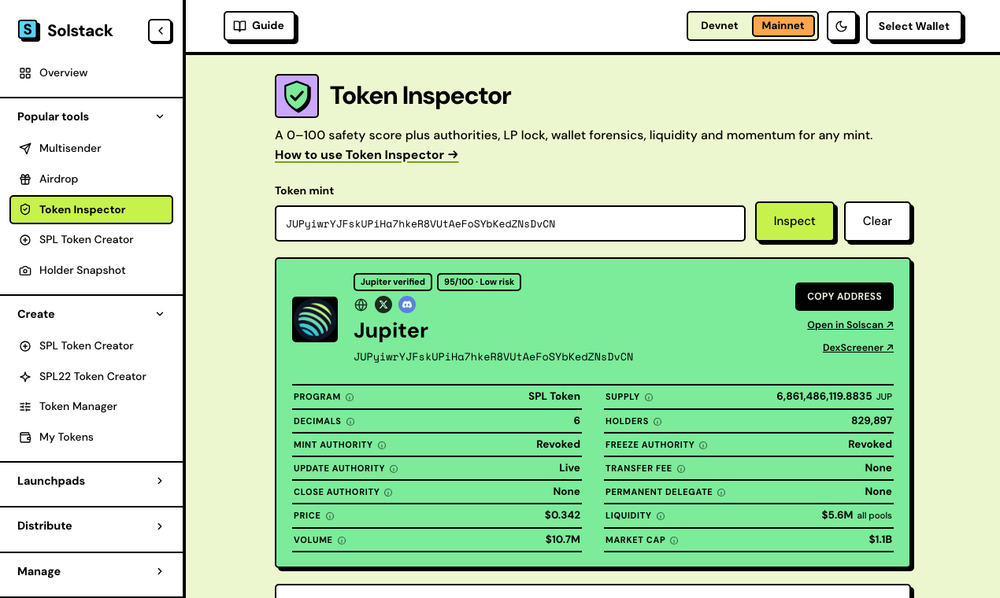
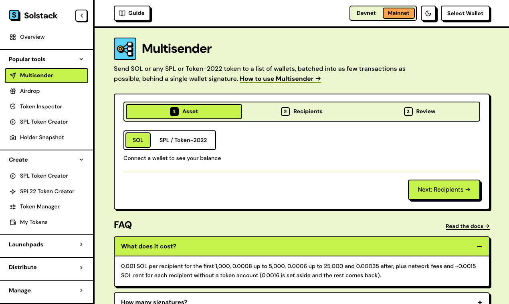
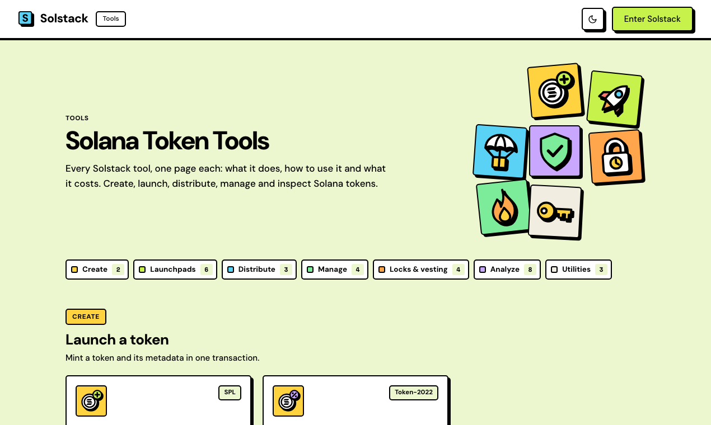

  

<h1 align="center">Solstack</h1>

  Web tools to create, launch, airdrop, multisend and inspect Solana tokens. 
  <a href="https://solstack.xyz"><b>solstack.xyz</b></a> ·
  <a href="https://solstack.xyz/tools">All tools</a> ·
  <a href="https://solstack.xyz/docs/overview">Docs</a> ·
  <a href="https://solstack.xyz/blog">Blog</a> ·
  <a href="https://solstack.xyz/academy">Academy</a>

  

  

Solstack is a browser toolkit for Solana tokens: create an SPL or Token-2022 token, launch on pump.fun, letsbonk.fun, Meteora or StonkFun, send to thousands of wallets, airdrop to every holder of another token, clean up wallets, and check any token's rug risk before you buy.

- **No account, no install.** Open a tool, connect Phantom, Solflare, Ledger or any Solana wallet, and approve in your wallet. Your keys stay in your wallet.
- **On Solana Mobile too.** On a Seeker or Saga phone, the same tools are the Solstack app in the Solana dApp Store, signing with Seed Vault or any wallet on the phone.
- **Try it on devnet.** Most tools also run on devnet, so you can rehearse with free SOL from the built-in [devnet faucet](https://solstack.xyz/tools/solana-devnet-faucet).
- **Read-only tools are free** and work without a wallet: [Token Inspector](https://solstack.xyz/tools/solana-token-inspector), [Transaction Inspector](https://solstack.xyz/tools/solana-transaction-inspector), [Account Inspector](https://solstack.xyz/tools/solana-account-inspector), [Network Status](https://solstack.xyz/tools/solana-network-status).

This repository is Solstack's home on GitHub: the tool list, guides, and the open-source scripts below. The web app itself isn't open source.

## Tools

tools: 34
### Create a token

| Tool | What it does | Guide |
|---|---|---|
| [SPL Token Creator](https://solstack.xyz/tools/create-solana-spl-token) | Mint a standard SPL token with name, symbol and logo in one transaction, with optional authority revocation. | [Docs](https://solstack.xyz/docs/create-solana-spl-token) |
| [Token-2022 Creator](https://solstack.xyz/tools/create-solana-token-2022) | A Token-2022 mint with on-mint metadata and optional extensions: transfer tax, interest and more. | [Docs](https://solstack.xyz/docs/create-solana-token-2022) |

### Launch

| Tool | What it does | Guide |
|---|---|---|
| [pump.fun Launcher](https://solstack.xyz/tools/launch-token-on-pumpfun) | Launch a coin on pump.fun with your first buy in the same transaction. | [Docs](https://solstack.xyz/docs/launch-token-on-pumpfun) |
| [letsbonk.fun Launcher](https://solstack.xyz/tools/launch-token-on-letsbonk) | Launch on Raydium LaunchLab, the curve behind letsbonk.fun, with an atomic first buy. | [Docs](https://solstack.xyz/docs/launch-token-on-letsbonk) |
| [Meteora DBC Launcher](https://solstack.xyz/tools/launch-token-on-meteora-dbc) | Launch on a Meteora Dynamic Bonding Curve with your first buy in the same transaction. | [Docs](https://solstack.xyz/docs/launch-token-on-meteora-dbc) |
| [StonkFun Launcher](https://solstack.xyz/tools/launch-token-on-stonkfun) | Launch a coin on StonkFun paired against SOL, a tokenized stock, another crypto or another coin. | [Docs](https://solstack.xyz/docs/launch-token-on-stonkfun) |
| [Creator Fees](https://solstack.xyz/tools/claim-solana-creator-fees) | Claim the creator fees your coins earn on pump.fun, LaunchLab and Meteora. | [Docs](https://solstack.xyz/docs/claim-solana-creator-fees) |
| [Launchpad](https://solstack.xyz/tools/solana-token-launchpad) | Presale or fair launch with escrowed tokens, automatic Raydium listing and burned or locked LP. *Devnet only for now.* | [Docs](https://solstack.xyz/docs/solana-token-launchpad) |

### Liquidity and trading bots

| Tool | What it does | Guide |
|---|---|---|
| [Add Liquidity](https://solstack.xyz/tools/add-liquidity-solana) | Find every pool that holds a token on Raydium, Meteora, Orca and PumpSwap, and deposit into one from your wallet. | [Docs](https://solstack.xyz/docs/add-liquidity-solana) |
| [Remove Liquidity](https://solstack.xyz/tools/remove-liquidity-solana) | Find every LP token and liquidity position in your wallet on Raydium, Meteora, Orca and PumpSwap, and withdraw from any of them. | [Docs](https://solstack.xyz/docs/remove-liquidity-solana) |
| [Grid Trading Bot](https://solstack.xyz/tools/solana-grid-trading-bot) | A bot that buys a token as its price falls through a ladder of lines and sells one line higher, from a wallet of its own. | [Docs](https://solstack.xyz/docs/solana-grid-trading-bot) |
| [DLMM Liquidity Bot](https://solstack.xyz/tools/meteora-dlmm-liquidity-bot) | A bot that keeps a Meteora DLMM position around the price, earning swap fees and re-centring when the price moves away. | [Docs](https://solstack.xyz/docs/meteora-dlmm-liquidity-bot) |

### Send and airdrop

| Tool | What it does | Guide |
|---|---|---|
| [Multisender](https://solstack.xyz/tools/solana-multisender) | Send SOL or any token to a list of wallets from a CSV, batched into as few transactions as possible. | [Docs](https://solstack.xyz/docs/solana-multisender) |
| [Airdrop](https://solstack.xyz/tools/solana-token-airdrop) | Send a token to every holder of another token, a flat amount each or split pro-rata. | [Docs](https://solstack.xyz/docs/solana-token-airdrop) |
| [Wallet Aggregator](https://solstack.xyz/tools/solana-wallet-aggregator) | Collect one token, or every token, from many wallets into a single destination. | [Docs](https://solstack.xyz/docs/solana-wallet-aggregator) |

### Manage tokens and wallets

| Tool | What it does | Guide |
|---|---|---|
| [Token Manager](https://solstack.xyz/tools/solana-token-manager) | Mint more supply, burn, revoke mint and freeze authorities, or update metadata for any mint you control. | [Docs](https://solstack.xyz/docs/solana-token-manager) |
| [Token Burner](https://solstack.xyz/tools/burn-solana-tokens) | Destroy tokens from your wallet, permanently. | [Docs](https://solstack.xyz/docs/burn-solana-tokens) |
| [Rent Reclaim](https://solstack.xyz/tools/reclaim-solana-rent) | Close empty token accounts, burn dead tokens and NFTs, and recover the rent: about 0.002 SOL each. | [Docs](https://solstack.xyz/docs/reclaim-solana-rent) |
| [Wallet Cleaner](https://solstack.xyz/tools/solana-wallet-cleaner) | Close empty accounts and burn dust or NFTs across throwaway wallets, then sweep their SOL to one address. | [Docs](https://solstack.xyz/docs/solana-wallet-cleaner) |

### Lock

| Tool | What it does | Guide |
|---|---|---|
| [Token Locker](https://solstack.xyz/tools/solana-token-locker) | Time-lock or vest any token in a program-owned vault, delivered automatically on schedule. *Devnet only for now.* | [Docs](https://solstack.xyz/docs/solana-token-locker) |
| [Token Lock Verifier](https://solstack.xyz/tools/solana-token-lock-verifier) | Every active lock on a mint: how much, for whom and until when. *Devnet only for now.* | [Docs](https://solstack.xyz/docs/solana-token-lock-verifier) |
| [LP Token Locker](https://solstack.xyz/tools/solana-lp-token-locker) | Lock LP tokens until a public unlock date anyone can verify. *Devnet only for now.* | [Docs](https://solstack.xyz/docs/solana-lp-token-locker) |
| [LP Lock Verifier](https://solstack.xyz/tools/solana-lp-lock-verifier) | Is the LP locked on a mint, how much of it, and until when. *Devnet only for now.* | [Docs](https://solstack.xyz/docs/solana-lp-lock-verifier) |

### Inspect and analyze

| Tool | What it does | Guide |
|---|---|---|
| [Token Inspector](https://solstack.xyz/tools/solana-token-inspector) | A 0–100 safety score plus authorities, LP lock, wallet forensics, liquidity and momentum for any mint. | [Docs](https://solstack.xyz/docs/solana-token-inspector) |
| [Holder Snapshot](https://solstack.xyz/tools/solana-token-holder-snapshot) | A CSV of every wallet holding a token or NFT collection. | [Docs](https://solstack.xyz/docs/solana-token-holder-snapshot) |
| [Smart Money Tracker](https://solstack.xyz/tools/solana-smart-money-tracker) | The top 100 holders of a token: how many trade profitably on other tokens, and how long they've held. | [Docs](https://solstack.xyz/docs/solana-smart-money-tracker) |
| [My Tokens](https://solstack.xyz/tools/my-solana-tokens) | Every token this wallet created, in one place. | [Docs](https://solstack.xyz/docs/my-solana-tokens) |
| [StonkFun Rewards](https://solstack.xyz/tools/stonkfun-rewards-tracker) | Which of a wallet's holdings are StonkFun reward coins, and roughly how much they've paid holders. | [Docs](https://solstack.xyz/docs/stonkfun-rewards-tracker) |
| [Transaction Inspector](https://solstack.xyz/tools/solana-transaction-inspector) | Status, fee, instructions and balance changes for any signature. | [Docs](https://solstack.xyz/docs/solana-transaction-inspector) |
| [Account Inspector](https://solstack.xyz/tools/solana-account-inspector) | What any address is and what's on-chain about it. | [Docs](https://solstack.xyz/docs/solana-account-inspector) |
| [Network Status](https://solstack.xyz/tools/solana-network-status) | Live TPS, priority fees, slot, epoch and RPC version. | [Docs](https://solstack.xyz/docs/solana-network-status) |

### Utilities

| Tool | What it does | Guide |
|---|---|---|
| [Sign & Verify](https://solstack.xyz/tools/sign-verify-solana-message) | Sign a message to prove wallet ownership, or verify a signature. | [Docs](https://solstack.xyz/docs/sign-verify-solana-message) |
| [Vanity Address](https://solstack.xyz/tools/solana-vanity-address-generator) | A keypair whose address starts or ends with your text, ground in your browser. | [Docs](https://solstack.xyz/docs/solana-vanity-address-generator) |
| [Devnet Faucet](https://solstack.xyz/tools/solana-devnet-faucet) | Test SOL on devnet or testnet. | [Docs](https://solstack.xyz/docs/solana-devnet-faucet) |

## Screenshots

  
  

  

## Open-source scripts

Small Node.js scripts for the same jobs from a terminal, MIT licensed:

| Repo | What it does |
|---|---|
| [solana-multisender](https://github.com/solstackxyz/solana-multisender) | Send SOL or any SPL / Token-2022 token to many wallets from a CSV |
| [solana-rent-reclaim](https://github.com/solstackxyz/solana-rent-reclaim) | Close empty token accounts and get the rent SOL back |
| [solana-holder-snapshot](https://github.com/solstackxyz/solana-holder-snapshot) | Every wallet holding a token, as a CSV, with pools marked |

## Telegram bot

[@SolstackScanBot](https://t.me/SolstackScanBot) gives any Solana token's 0–100 safety score in chat: send it a mint address.

## Learn Solana

- [Solstack Academy](https://solstack.xyz/academy): lessons on how Solana works, from blockchains to token accounts and rent
- [Blog](https://solstack.xyz/blog): guides on creating tokens, airdrops, rent and spotting rugs
- [Docs](https://solstack.xyz/docs/overview): a step-by-step guide for every tool

## Links

[Website](https://solstack.xyz) · [X](https://x.com/solstack_xyz) · [YouTube](https://www.youtube.com/@Solstack) · [Telegram](https://t.me/solstack_xyz) · [Medium](https://solstackxyz.medium.com) · support@solstack.xyz
